# CANCERWISE AI — Data Preprocessing Pipeline Documentation

---

> [!IMPORTANT]
> **Data Integrity & Clinical Leakage Prevention:**
> All preprocessing transformations are encapsulated in reusable scikit-learn compatible transformer pipelines. Imputation statistics, scaling parameters ($\mu, \sigma, \text{IQR}$), and winsorization thresholds are fitted exclusively on training splits and applied out-of-fold to validation and test splits to prevent data leakage.

---

## 1. Architectural Pipeline Overview

The CANCERWISE AI preprocessing architecture standardizes, cleans, and transforms raw tabular biomedical data before feature engineering and model induction.

```mermaid
flowchart LR
    Raw["Raw Cytological Data"] --> Val["Schema & Type Validation"]
    Val --> Dup["Deduplication & Anomaly Filter"]
    Dup --> Imp["Missing Value Imputation"]
    Imp --> Out["Outlier Detection & Winsorization"]
    Out --> Skew["Skewness Mitigation (Yeo-Johnson)"]
    Skew --> Scale["Robust / Standard Feature Scaling"]
    Scale --> Proc["Preprocessed Dataset (Parquet)"]
```

---

## 2. Preprocessing Modules & Algorithms

### 2.1 Schema & Type Validation (`preprocessing/data_validator.py`)
- Verifies column presence against the canonical 32-attribute WDBC schema.
- Enforces strict float64 data types across all 30 cytological measurements.
- Asserts presence and integrity of target label (`diagnosis`) with binary values (`Benign`/`Malignant` or `0`/`1`).
- Asserts strict non-negative constraints on physical spatial metrics (radius, perimeter, area, concave points $\ge 0$).

### 2.2 Missing Value Imputation (`preprocessing/missing_values.py`)
While the standard benchmark WDBC dataset contains zero missing values, clinical practice frequently encounters incomplete diagnostic records. The module supports four strategies:
1. **Median Imputation (Default):** Replaces missing numerical attributes with the median of the feature distribution, robust to extreme outliers.
2. **Mean Imputation:** Replaces missing values with the arithmetic mean.
3. **KNN Imputation:** Imputes missing values using Euclidean distance weighted average of the $k$-nearest neighbor samples ($k=5$).
4. **Iterative SVD / MissForest:** Chained equation imputation modeling each missing feature as a function of all remaining features.

### 2.3 Outlier Detection & Winsorization (`preprocessing/outlier_detector.py`)
In oncological cytological data, extreme values may represent either measurement artifacts or clinically significant aggressive malignant phenotypes (e.g. giant nuclear pleomorphism).
- **Z-Score Detection:** Flags observations with $|z| > 3.0$.
- **Interquartile Range (IQR) / Tukey Bounds:**
  $$\text{Lower Bound} = Q_1 - 1.5 \times \text{IQR}, \quad \text{Upper Bound} = Q_3 + 1.5 \times \text{IQR}$$
- **Isolation Forest:** Multi-dimensional isolation tree anomaly score identifying multivariate outliers.
- **Outlier Handling Policy:**
  - *Winsorization / Clipping:* Values outside $[Q_{0.01}, Q_{0.99}]$ are capped rather than dropped, preserving statistical sample size ($N=569$) while attenuating gradient instability in neural networks and linear models.

### 2.4 Skewness Mitigation (`preprocessing/transformers.py`)
Features reflecting spatial area (`area_mean`, `area_se`, `area_worst`) and variances exhibit strong right-skewness ($s > 1.5$).
- **Yeo-Johnson Transformation:**
  $$\psi(\lambda, y) = \begin{cases} ((y + 1)^\lambda - 1)/\lambda & \text{if } \lambda \neq 0, y \ge 0 \\ \ln(y + 1) & \text{if } \lambda = 0, y \ge 0 \\ -((-y + 1)^{2 - \lambda} - 1)/(2 - \lambda) & \text{if } \lambda \neq 2, y < 0 \\ -\ln(-y + 1) & \text{if } \lambda = 2, y < 0 \end{cases}$$
  Handles zero and positive continuous values seamlessly without manual shifting.

### 2.5 Feature Scaling & Normalization
1. **StandardScaler:** Zero mean, unit variance ($\mu = 0, \sigma = 1$). Preferred for Gaussian-distributed metrics and logistic regression.
2. **RobustScaler:** Median centering and IQR scaling ($x' = \frac{x - \text{median}}{\text{IQR}}$), impervious to persistent high-leverage observations.
3. **MinMaxScaler:** Rescaling to $[0, 1]$ interval, essential for Multilayer Perceptron (MLP) input bounds and distance metrics in KNN.

---

## 3. Data Downcasting & Memory Optimization

Memory downcasting benchmarks:
- `float64` converted to `float32` where double precision is not strictly required, reducing memory footprint by 50% with zero loss of classification AUC ($>0.99$).
- `id` column downcasted to `int32`.
- Categorical target converted to unsigned 8-bit integer (`uint8`).
