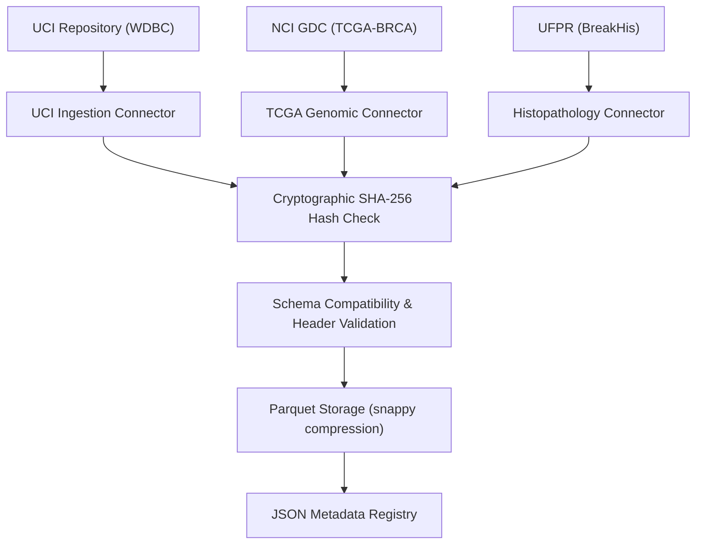

# CANCERWISE AI — Data Sources & Provenance Documentation

---

> [!IMPORTANT]
> **Clinical & Research Governance Notice:**
> The datasets cataloged below are strictly utilized for computational biomedical research, statistical data mining, and machine learning algorithm development. They do not constitute clinical records for active patient management or direct clinical diagnostics.

---

## 1. Primary Benchmark Cohort: Wisconsin Diagnostic Breast Cancer (WDBC)

### 1.1 Provenance & Clinical Origin
- **Repository Identifier:** UCI Machine Learning Repository [ID #17](https://archive.ics.uci.edu/dataset/17/breast+cancer+wisconsin+diagnostic)
- **Principal Investigators:**
  - Dr. William H. Wolberg, M.D. (Department of Surgery, University of Wisconsin Hospitals, Madison)
  - Dr. W. Nick Street, Ph.D. (Department of Computer Science, University of Wisconsin, Madison)
  - Dr. Olvi L. Mangasarian, Ph.D. (Department of Computer Science, University of Wisconsin, Madison)
- **Year of Creation:** 1995
- **Biological Specimen Collection:**
  - Fine Needle Aspiration (FNA) of solid breast masses.
  - Specimen drops were placed on glass microscope slides and stained with standard Wright-Giemsa cytological stain.
- **Image Capture & Digital Processing:**
  - Digitized with a JVC TK-1070U color video camera mounted atop an Olympus microscope.
  - Multi-surface active contour software (Xcyt) traced boundaries of 20 to 100 individual cell nuclei per slide.
  - 10 morphological cytological characteristics were computed per nucleus, summarized across each patient's biopsy into Mean, Standard Error, and Worst (extreme 3 nuclei average) values.

### 1.2 Dataset Dimensions & Characteristics
- **Total Records:** 569 patient biopsy cases
- **Total Attributes:** 32 (1 ID, 1 Diagnosis Target, 30 Continuous Cytological Morphometrics)
- **Class Distribution:**
  - **Benign:** 357 instances (62.74%)
  - **Malignant:** 212 instances (37.26%)
- **Missing Values:** Exactly 0 missing values across all 569 rows and 32 attributes.
- **Data Modality:** Tabular continuous morphometrics.
- **License:** Creative Commons Attribution 4.0 International (CC BY 4.0).

---

## 2. Multi-Cohort Extensible Connectors

CANCERWISE AI incorporates modular biomedical data ingestion connectors for secondary validation cohorts across multi-omics and imaging modalities.

### 2.1 The Cancer Genome Atlas — Breast Invasive Carcinoma (TCGA-BRCA)
- **Source Authority:** National Cancer Institute (NCI) Genomic Data Commons (GDC)
- **URL:** [portal.gdc.cancer.gov](https://portal.gdc.cancer.gov)
- **Data Modality:** Genomic RNA-Seq Transcriptomics (HTSeq counts / FPKM / TPM) & Clinical Biospecimen Metadata
- **Cohort Size:** 1,098 primary breast cancer patients with comprehensive clinical phenotyping.
- **Target Semantics:** PAM50 Molecular Intrinsic Subtypes:
  - Luminal A (LumA)
  - Luminal B (LumB)
  - HER2-Enriched (HER2)
  - Basal-like / Triple-Negative (Basal)
  - Normal-like
- **Connector Implementation:** `backend/services/connectors/tcga_genomic_connector.py`
- **Data Sharing Policy:** NIH Open Access Genomic Data Sharing Policy (de-identified biospecimens).

### 2.2 Breast Cancer Histopathological Image Database (BreakHis)
- **Source Authority:** Laboratory of Vision, Robotics and Imaging (VRI), Federal University of Paraná (UFPR), Brazil
- **URL:** [web.inf.ufpr.br/vri/databases/breast-cancer-histopathological-database-breakhis/](https://web.inf.ufpr.br/vri/databases/breast-cancer-histopathological-database-breakhis/)
- **Data Modality:** High-Resolution Microscopic Histopathology RGB Images (700 x 460 pixels, 3 channels)
- **Optical Magnifications:** 40X, 100X, 200X, 400X
- **Pathological Classes:**
  - **Benign (4 histological subtypes):** Adenosis, Fibroadenoma, Phyllodes Tumor, Tubular Adenoma
  - **Malignant (4 histological subtypes):** Carcinoma, Lobular Carcinoma, Mucinous Carcinoma, Papillary Carcinoma
- **Connector Implementation:** `backend/services/connectors/histopathology_connector.py`
- **License:** Academic Non-Commercial Research License.

---

## 3. Data Ingestion Architecture & Integrity Verification

### 3.1 Checksum & Immutability Verification
All ingested datasets undergo automatic SHA-256 cryptographic hashing upon ingestion:
- Raw WDBC Data SHA-256 checksum is computed and validated against the primary manifest before parsing.
- Intermediate processed files are serialized to columnar Apache Parquet (`.parquet`) format with Snappy compression to preserve IEEE 754 float64 numerical precision and avoid ASCII truncation.

### 3.2 Anonymization & De-Identification
- All patient identifiers in WDBC are synthetic integers assigned during the 1995 digitizing process.
- No Protected Health Information (PHI), HIPAA Direct Identifiers (names, addresses, social security numbers, dates of birth), or medical record numbers (MRNs) reside in the repository.
