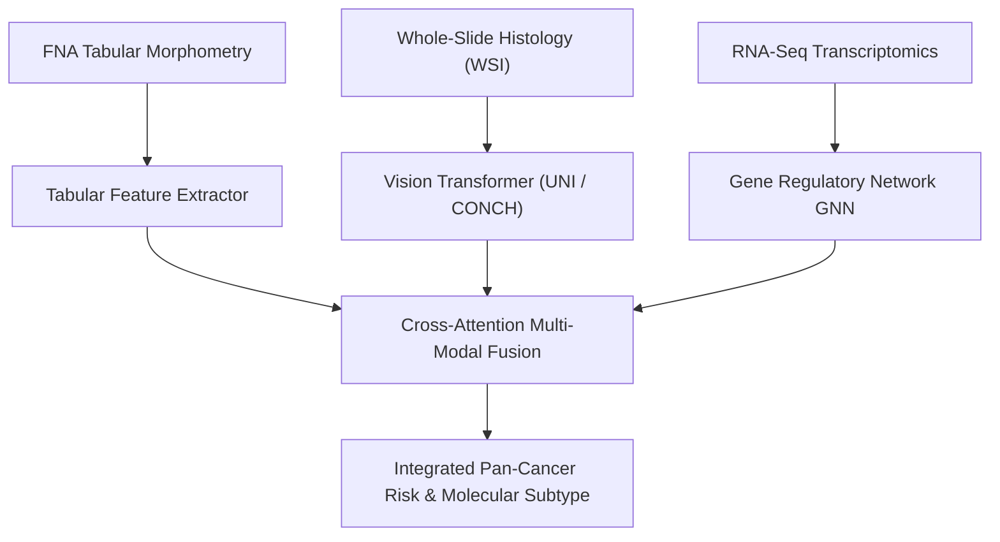

# CANCERWISE AI — Future Enhancements & Technological Roadmap

---

## 1. Multi-Modal Biomedical Fusion Architecture

While current models evaluate 30 cytological continuous features, future versions of CANCERWISE AI will implement late and intermediate multi-modal fusion combining tabular morphometry, digital histopathology, and genomic transcriptomics.

1. **Pathology Foundation Model Integration**:
   Incorporate pre-trained pathology vision models (Harvard's UNI, Memorial Sloan Kettering's CONCH) for patch-level feature extraction on gigapixel whole-slide imaging.
2. **Genomic Subtyping**:
   Directly fuse PAM50 mRNA expression with cytological features to predict chemotherapy response and recurrence risk (Oncotype DX / MammaPrint surrogates).

---

## 2. Federated Learning & Privacy-Preserving AI

To overcome single-institution sample limitations without centralizing sensitive Protected Health Information (PHI):
- **Federated Averaging (FedAvg)**: Train models iteratively across multi-center hospital nodes without exchanging patient records.
- **Differential Privacy (DP-SGD)**: Add calibrated Gaussian noise to model parameter updates, guaranteeing $(\epsilon, \delta)$-differential privacy against model inversion attacks.

---

## 3. Hospital EHR & Clinical Standards Integration

- **HL7 FHIR (Fast Healthcare Interoperability Resources)**:
  Implement FHIR R4 RESTful interfaces to pull patient pathology lab requisitions (`Observation`, `DiagnosticReport`) and post structured diagnostic risk assessments back to Epic / Cerner electronic medical record systems.
- **DICOM-WSI Standard**:
  Direct ingestion of digital slide archives stored in standard DICOM Whole Slide Microscopy format (Supplement 145).

---

## 4. Active Learning & Human-in-the-Loop Refinement

- Interactive pathologist feedback loop where cases with high prediction entropy ($0.40 \le \hat{p} \le 0.60$) or conflicting morphological cues are routed to human annotators for expert slide re-examination.
- Continual incremental model retraining using the Large-Scale learning pipelines developed in Phase 8 (`IncrementalSGDClassifier`).
