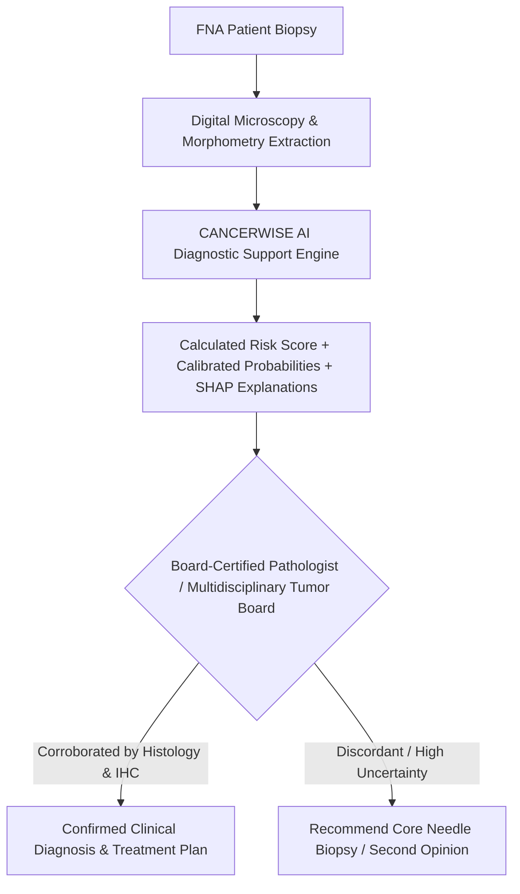

# CANCERWISE AI — Limitations, Ethical Governance & Clinical Disclaimers

---

> [!CAUTION]
> **Mandatory Regulatory & Diagnostic Boundary Disclaimer:**
> **CANCERWISE AI is an educational research and clinical decision-support prototype.**
> It has NOT received 510(k) clearance or PMA approval from the United States Food and Drug Administration (FDA), CE marking under European Union In Vitro Diagnostic Medical Devices Regulation (IVDR), or approval from any national healthcare regulatory agency.
> **DO NOT USE THIS SOFTWARE AS AN AUTONOMOUS DIAGNOSTIC SYSTEM FOR PATIENT MANAGEMENT OR TREATMENT PLANNING.**

---

## 1. Dataset & Methodological Limitations

### 1.1 Retrospective Single-Institution Cohort
- The Wisconsin Diagnostic Breast Cancer (WDBC) dataset was collected between 1989 and 1995 at the University of Wisconsin Hospitals, Madison.
- The sample size of $N=569$ represents a single geographic and clinical setting.
- Sociodemographic variables (patient age, ethnicity, menopausal status, family history) were not recorded, precluding algorithmic fairness audits across protected demographic subgroups.

### 1.2 Fine Needle Aspiration (FNA) Technological Context
- FNA cytological specimens assess nuclear morphometry in isolated aspirated fluid droplets.
- FNA cannot evaluate **tissue architecture, basement membrane invasion, stromal desmoplasia, or microvascular invasion**, which require formalin-fixed paraffin-embedded (FFPE) histological core needle biopsies or surgical excisions.
- **Diagnostic Labeling vs Clinical Staging:**
  CANCERWISE AI models classify cellular specimens as **Benign** or **Malignant**. They **DO NOT** perform clinical staging (Stage 0, I, II, III, IV), which strictly depends on tumor size ($T$), regional lymph node involvement ($N$), and distant metastasis ($M$).

### 1.3 Out-of-Distribution (OOD) Vulnerability
- Models trained on standardized digitized FNA slides cannot generalize directly to uncalibrated smartphone digital cameras, whole-slide histology images (WSI), or alternative cytological preparations (e.g. ThinPrep / Pap staining) without domain adaptation.

---

## 2. Ethical Considerations & AI Bias Mitigation

### 2.1 Automation Bias & Over-Reliance
- **Risk:** Clinicians may uncritically accept automated predictions due to perceived mathematical objectivity, potentially leading to diagnostic premature closure.
- **Mitigation:** The user interface prominently presents uncertainty intervals, calibration reliability metrics, and explicit reminders that predictions represent statistical hypotheses.

### 2.2 Spectrum Bias
- In community screening settings, breast cancer prevalence is approximately 0.5%–1.0%. The WDBC cohort has an enriched prevalence of 37.26% ($212 / 569$), reflecting a symptomatic referral population.
- Unadjusted positive predictive values (PPV) will be markedly lower in true asymptomatic screening populations (demonstrated via Bayes' theorem in the Evaluation page).

### 2.3 Environmental & Computational Impact
- Training lightweight classical machine learning models (Logistic Regression, Random Forest) consumes minimal electrical energy ($<0.01\text{ kWh}$ per run), adhering to Green AI principles.

---

## 3. Human-in-the-Loop Governance Protocol

The algorithm serves exclusively as an auxiliary cognitive aid. All clinical actions remain under the sole authority of qualified medical practitioners.
