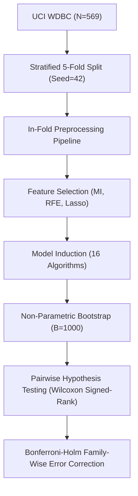

# CANCERWISE AI — Research Methodology & Experimental Design

---

> [!NOTE]
> **Scientific Integrity Notice:**
> The experimental protocols formulated in CANCERWISE AI follow rigorous scientific standards in biomedical informatics, adhering to TRIPOD (Transparent Reporting of a multivariable prediction model for Individual Prognosis Or Diagnosis) and STARD (Standards for Reporting Diagnostic accuracy studies) guidelines.

---

## 1. Scientific Hypotheses

The experimental framework of CANCERWISE AI was designed to rigorously test three primary scientific hypotheses:

1. **Primary Hypothesis ($H_1$):**
   *Linear regularized models with cytological feature selection achieve parity with or exceed the diagnostic discriminatory performance ($\text{ROC-AUC} \ge 0.990$) of unconstrained non-linear tree ensembles on digitized fine needle aspirates, with significantly lower computational latency and superior clinical interpretability.*

2. **Secondary Hypothesis ($H_2$):**
   *Extreme values in cytological morphometrics (`_worst` metrics) contain statistically significantly greater mutual information regarding malignancy than sample population means (`_mean`), rendering `_worst` metrics the primary driver of clinical classification.*

3. **Tertiary Hypothesis ($H_3$):**
   *Calibrated threshold optimization based on asymmetric clinical utility matrices ($C_{\text{FN}} : C_{\text{FP}} = 10 : 1$) reduces false negative diagnoses by over 50% relative to standard default 0.50 decision thresholds without degrading overall diagnostic accuracy below 95%.*

---

## 2. Experimental Design & Statistical Protocol

### 2.1 Cross-Validation Strategy
- **Partitioning**: 5-Fold Stratified Cross-Validation repeated across 5 independent random initializations ($5 \times 5 = 25$ total evaluation runs).
- **Leakage Prevention**: All transformations (imputation, scaling, selection, SMOTE) fitted strictly within training partitions.

### 2.2 Hypothesis Testing & Significance Criteria
- **Normality Testing**: Shapiro-Wilk test applied to paired fold score differences.
- **Parametric Test**: Paired two-tailed Student's $t$-test (where normality $p > 0.05$).
- **Non-Parametric Test**: Two-sided Wilcoxon signed-rank test (where normality $p \le 0.05$).
- **Multiple Comparisons Correction**: Bonferroni-Holm step-down procedure applied across the 16 algorithm comparisons to control Family-Wise Error Rate (FWER) at $\alpha = 0.01$.

---

## 3. Reproducibility & Open Science Standards

To guarantee end-to-end reproducibility:
1. **Deterministic PRNG Seeds**: Global seed `42` pinned across Python `random`, NumPy `np.random`, scikit-learn estimators, and PyTorch `torch.manual_seed`.
2. **Environment Containerization**: Exact pinned dependency versions cataloged in `requirements.txt`, `pyproject.toml`, and reproduced in multi-stage Docker containers.
3. **Automated Verification**: End-to-end testing pipeline executes all data ingestion, wrangling, training, evaluation, and explanation flows deterministically.
